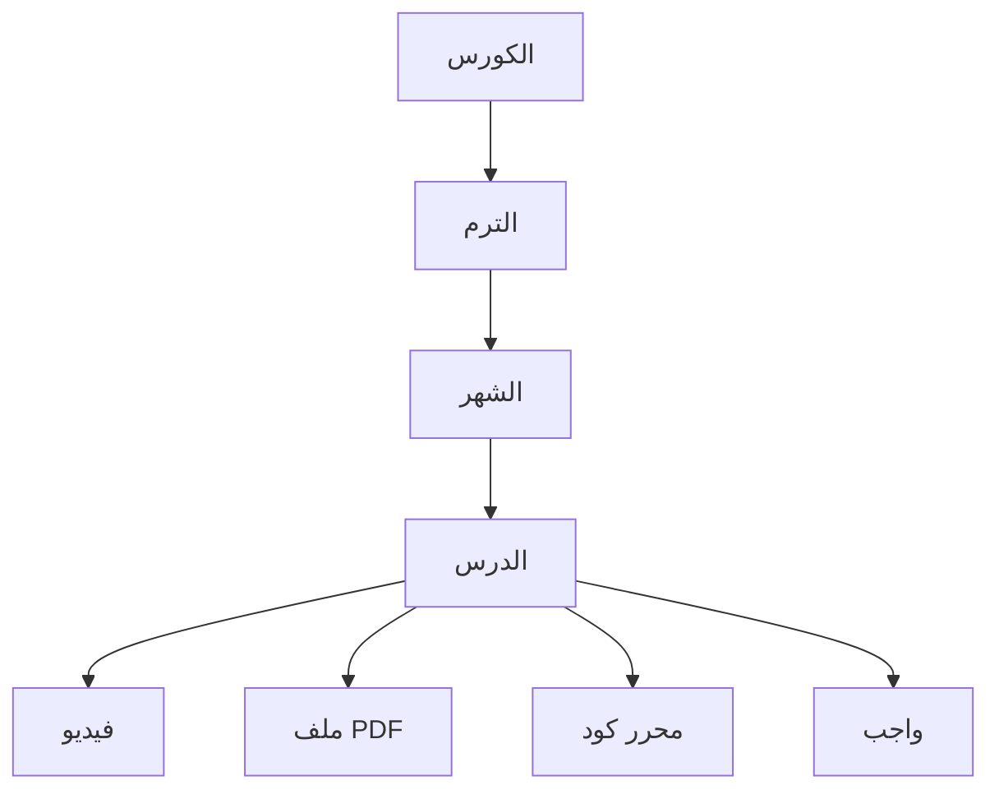
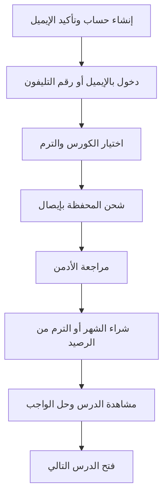
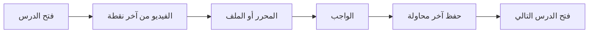
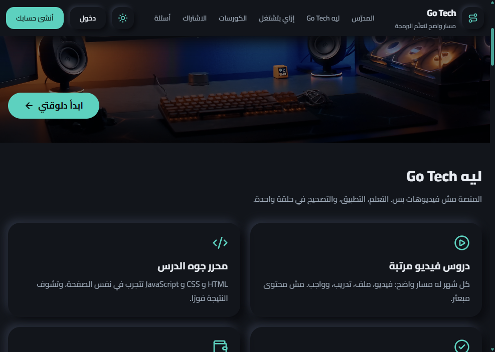
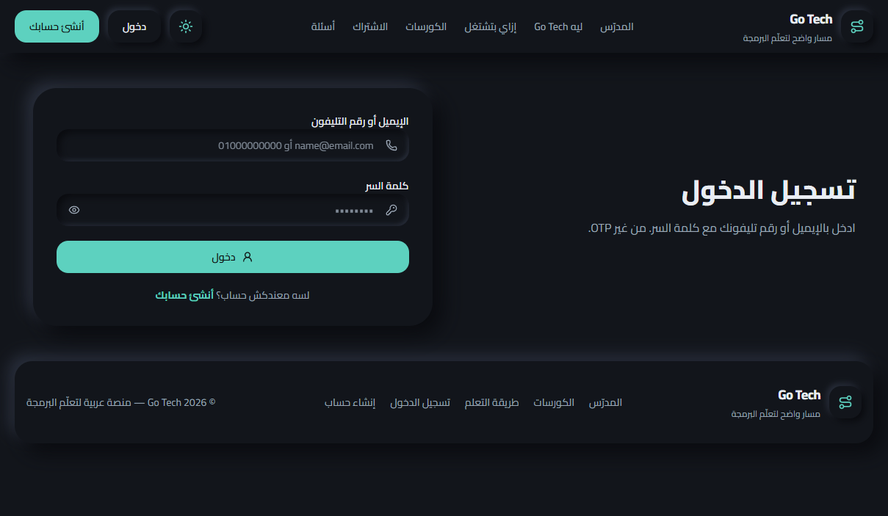
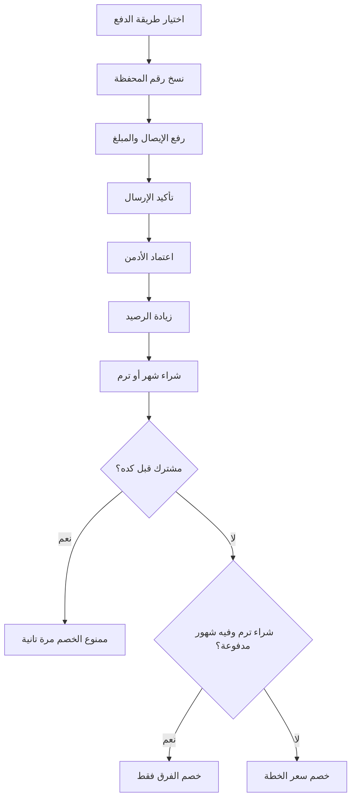

# Go Tech

منصة عربية لإدارة التعلم (Learning Management System) موجهة لطلاب الثانوية في مصر، عشان يتعلموا البرمجة في مسار واضح: فيديو، تطبيق، واجب، وبعدين الدرس اللي بعده.

English: an Arabic-first LMS for Egyptian secondary students. Courses are organized as course, term, month, and lesson, with a student wallet, timed exams, and an admin dashboard.

## الفكرة

الطالب مش محتاج مجموعة فيديوهات متفرقة. محتاج يعرف هو فين في المنهج، يدفع بطريقة تناسب الأسرة، ويحل واجب يتصحح في لحظتها قبل ما الدرس الجاي يتفتح.

Go Tech بتجمع المحتوى والدفع والمتابعة في مكان واحد، بواجهة عربية من اليمين لليسار، والمدرس بيتحكم في الكورسات والطلاب من لوحة تحكم مستقلة.

## الجمهور

- طلاب الثانوية اللي بيتعلموا البرمجة
- المدرس أو الأدمن اللي بينشر المحتوى ويراجع المدفوعات
- ولي الأمر اللي عايز يشوف الاشتراك والتقدم من غير تعقيد

## هيكل المحتوى

الشهر يتفتح لوحده، أو الترم كامل يتفتح مرة واحدة. لو الطالب اشترى شهر وبعدين قرر يشتري الترم، سعر الشهر اللي اتدفع قبل كده يتحسب خصم من سعر الترم.

## رحلة الطالب

الدخول بعد تأكيد الإيميل يكون بالإيميل أو رقم التليفون مع كلمة السر، من غير OTP في كل مرة.

## جوه الدرس

- الفيديو بيرجع لآخر موضع وقف عنده الطالب
- الواجب يفضل محفوظ بآخر محاولة، مش بيتقفل بعد أول حل
- أسئلة الدرس يقدر الطالب يعدّلها أو يمسحها، واسم الأدمن يظهر في الرد
- اسم الطالب يظهر كعلامة مائية صغيرة ومتحركة على الفيديو

## المميزات

### للطالب

- صفحة رئيسية فيها الكورسات، الدروس المكتملة، الرصيد، والإشعارات
- كورسات مقسمة حسب الصف الدراسي
- دروس فيها فيديو، PDF، ومحرر HTML و CSS و JavaScript
- واجبات بتصحيح فوري، والدرس التالي يتفتح بعد المطلوب
- امتحانات بميعاد بداية، وعدّ تنازلي، وتسليم تلقائي لما الوقت يخلص
- محفظة داخل الحساب: شحن بالإيصال، ثم شراء الشهر أو الترم من الرصيد
- محافظ مصر: فودافون كاش، أورانج كاش، وي كاش، اتصالات كاش، وإنستاباي، والأدمن يقدر يضيف أو يعدّل أو يحذف أي طريقة
- لايف حسب السنة الدراسية، وإشعارات
- تقدم محفوظ، ووضع فاتح وداكن

### للأدمن

- نظرة عامة على الطلاب والكورسات والمدفوعات
- بناء الكورس: ترم، شهر، درس
- واجبات وأسئلة، واستيراد الأسئلة
- امتحانات ونتائج المحاولات
- مراجعة إيصالات الشحن واعتماد الرصيد
- أسئلة الدروس والرد عليها
- لايف موجه لصف معيّن
- إشعارات للطلاب
- سجل أحداث الحماية على الدروس
- إعدادات الووترمارك وطرق الدفع

## الشاشات

الواجهة العامة داكنة، عربية، ومن اليمين لليسار.

### البداية

### ليه المنصة

### خطوات الاستخدام

### تسجيل الدخول

## الشراء من المحفظة

الاشتراك نفسه مش تحويل يدوي على كل شهر. الطالب يشحن المحفظة مرة، والأدمن يراجع الإيصال، وبعد الاعتماد الرصيد يتستخدم في الشراء.

قبل أي شراء أو إرسال يظهر تأكيد. الرجوع لصفحة شهر تم شراؤه لا يخصم من الرصيد تاني.

## التقنيات

| الطبقة | الاختيار |
| --- | --- |
| واجهة الطالب ولوحة التحكم | React و TypeScript و Vite |
| التنسيق | Tailwind CSS، واجهة عربية RTL |
| الحالة والبيانات | Redux Toolkit Query |
| قاعدة البيانات والدخول والملفات | Supabase |
| الاستضافة | Vercel |

المشروع تطبيقين: منصة الطالب، ولوحة تحكم الأدمن. الصلاحيات والخصم من المحفظة بتتنفذ على قاعدة البيانات، مش في الواجهة بس.

## حدود النسخة الحالية

- مجتمع الطلاب متوقف مؤقتًا
- شحن المحفظة بمراجعة يدوية للإيصال، وبعدها الشراء فوري من الرصيد
- الكود التشغيلي في ريبو خاص، والملف ده شرح عام للفكرة والميزات
